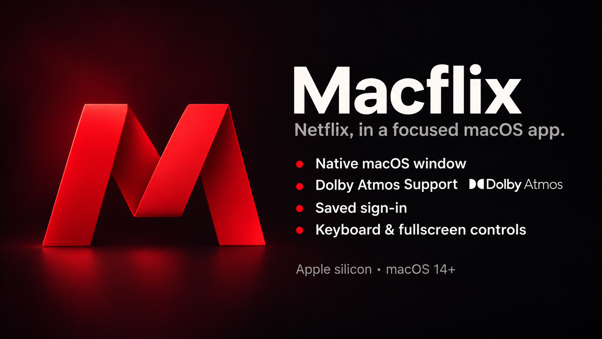

# Macflix

Macflix puts Netflix in a dedicated Mac window, with saved sign-in, keyboard playback controls, and optional experimental audio features.

[Download the latest release](https://github.com/Suhas-Neramya/macflix/releases/latest) · Apple silicon · macOS 14 or later

## Features

- **Up to 4K UHD:** Netflix can stream up to 4K on supported Mac setups. Your Netflix plan, the title, display, and network must meet Netflix's [Ultra HD requirements for Mac](https://help.netflix.com/en/node/55764). Netflix selects the stream quality; Macflix does not force 4K.
- **A native Mac window:** Resize the window or watch fullscreen.
- **Saved sign-in:** Macflix keeps your Netflix session in its own WebKit profile on this Mac. Sign in directly on Netflix; Macflix does not collect your Netflix password.
- **Keyboard controls:** Press Space or K to play or pause. Use the View menu or Control-Command-F to toggle fullscreen.
- **Automatic updates:** Sparkle checks for signed releases and offers updates in the app.
- **Experimental Dolby Atmos audio:** Macflix can request a compatible Atmos track and route supported audio through its native audio bridge. Availability depends on the title and audio setup; playback may fall back to WebKit, and Macflix cannot confirm actual Atmos rendering.

## Install

1. Download the Apple silicon DMG from [the latest release](https://github.com/Suhas-Neramya/macflix/releases/latest).
2. Open the DMG and drag Macflix into your Applications folder.
3. Open Macflix and sign in to your Netflix account.

If you already use Macflix, install this updater-enabled release manually once. Later signed releases can be offered in the app.

Macflix requires an Apple silicon Mac running macOS 14 or later and an internet connection. A Netflix account is required to watch.

The release is ad hoc signed and not notarized, so macOS may show a security warning on first launch. If you downloaded Macflix from the official release page and trust it, follow [Apple's steps for reviewing and opening an app](https://support.apple.com/en-us/102445). Do not approve an app you do not trust.

## About

Macflix is an independent project and is not affiliated with Netflix or Dolby. Netflix, Dolby, and Dolby Atmos are trademarks of their respective owners. The project is MIT licensed; see [LICENSE](LICENSE) for license terms and attribution. Inspired by [Matthew Daniel Murphy's netflix-native](https://github.com/mattdanielmurphy/netflix-native).
